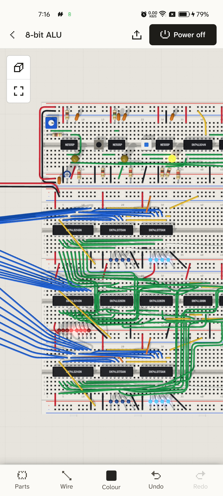
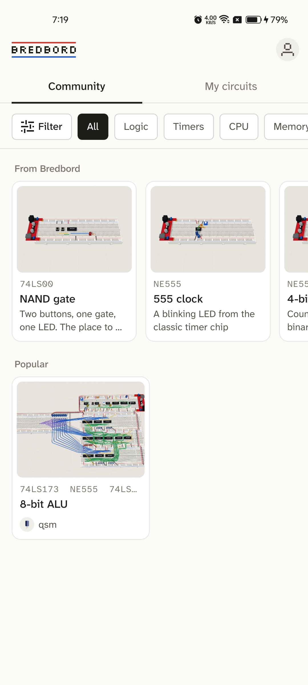
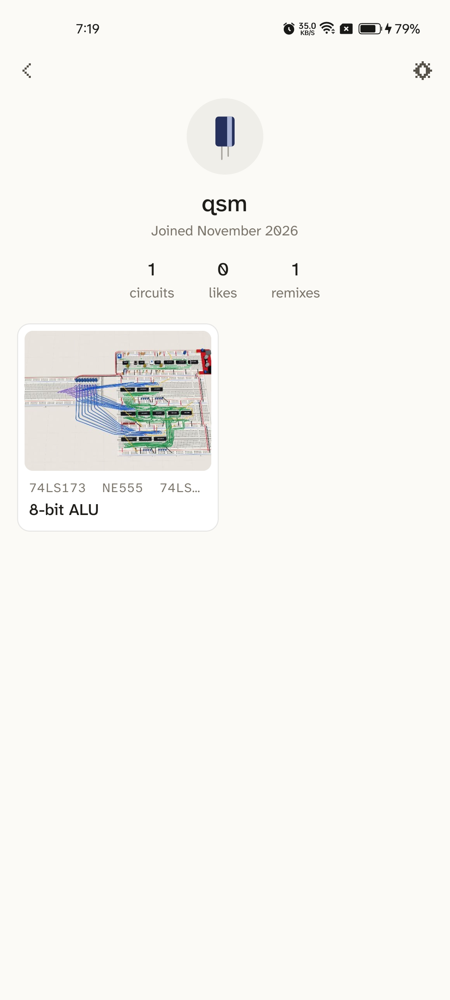

# Bredbord for Android

A breadboard and circuit simulator for Android. The desk and the simulator are shared with
[Bredbord](https://github.com/qs-1/bredbord), the website; how the two fit together is in
[ARCHITECTURE.md](ARCHITECTURE.md).

  

Get the app from [Releases](https://github.com/qs-1/bredbord-app/releases/latest) (64-bit Android phones).

## Build

Needs Node 22+, Java 21 and the Android SDK.

```bash
npm install
npx expo prebuild --platform android
cd android && ./gradlew assembleRelease -PreactNativeArchitectures=arm64-v8a
```

Accounts and sharing need a `.env` with `EXPO_PUBLIC_SUPABASE_URL`,
`EXPO_PUBLIC_SUPABASE_PUBLISHABLE_KEY` and `EXPO_PUBLIC_GOOGLE_WEB_CLIENT_ID` (the Google web client's
ID; see `supabase/README.md` in the website's repo). Without them the app works offline, signed out.
Google sign-in is native, so it needs a development build (`npx expo prebuild`, then
`npx expo run:android`), not Expo Go.

## License

MIT
